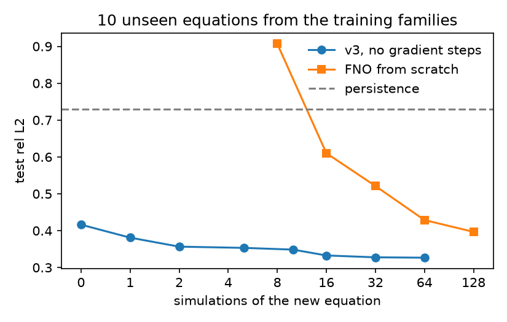

* Latent-Conditioned FNO
An FNO conditioned on a per-equation latent z, pretrained on ~5000 randomly generated 2D PDEs. For a new PDE, z comes from its equation graph and/or a few simulations of it, so the model can adapt with few or no gradient steps.

Two versions:
- v1: latent table + a graph encoder that gives a prior over z. On a new PDE, pick simulations with active learning and fine-tune.
- v3: a transformer reads the equation graph plus any number of simulations and outputs z in one forward pass (515M param FNO).

** Baseline
The baseline is the same FNO with no latent, trained from scratch on only N simulations of the new equation (10% held out for early stopping). For the plot below I drew 10 new equations from the data generator with a seed that wasn't used for training. Both models are tested on the same 40 held-out windows per equation, rel L2 of the main field over 14 frames, averaged over the 10 equations. v3 just gets the first k simulations as context, no training.

** Results
- 10 unseen equations from the training families: v3 with no simulations matches an FNO trained from scratch on ~83 simulations. With 1 simulation it beats scratch at 128.
- Held-out equation families: rel L2 0.45 -> 0.31 with 5 simulations, no gradient steps.
- New physics (shallow water, Aliev-Panfilov, wildfire): v1 fine-tuning needs ~12x fewer sims than scratch on Aliev-Panfilov (at scratch N=64) and ~2x on wildfire, but doesn't help on shallow water past ~8 sims. v3 doesn't beat fine-tuning here.

Numbers and caveats: =model/RESULTS.md= (v1), =model/results/ctx/RESULTS.md= (v3), =model/results/scratch_vs_ctx/RESULTS.md= (v3 vs scratch), =baseline_FNO/RESULTS.md=.

** Layout
- =data_collection/= :: PDE generator, spec format, solver
- =model/= :: conditioned FNO, training, eval, active learning, baselines
- =baseline_FNO/= :: plain FNO trained on N simulations, error vs data
