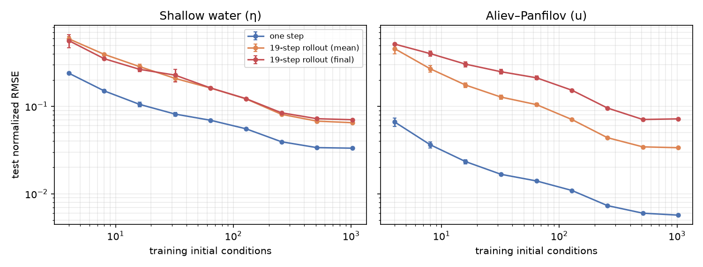

# FNO baseline: error vs. training data

No prior, no active learning: a plain FNO2d (4 Fourier layers, width 64, 16 modes, residual one-step map u(t) → u(t+Δt), MSE, AdamW + cosine, batch 16) trained on N random-IC rollouts of each held-out demo equation and tested on 128 unseen ICs. Data: generic spectral solver, 128², periodic, 20 evenly spaced frames per rollout (SWE Δt = 8 s, AP Δt = 2.5 t.u.). Steps per run = clip(15 epochs, 1500, 6000); 3 seeds (data subset + init) for N ≤ 64. Error = normalized RMSE of the primary field (RMSE / its test-set std); rollout = 19 autoregressive steps from the IC.

## Shallow water (η)

| train ICs | one step | rollout mean | rollout final |
|---:|---:|---:|---:|
| 4 | 0.239 ± 0.0055 | 0.592 ± 0.039 | 0.565 ± 0.097 |
| 8 | 0.15 ± 0.0058 | 0.393 ± 0.012 | 0.351 ± 0.0049 |
| 16 | 0.105 ± 0.006 | 0.285 ± 0.019 | 0.265 ± 0.016 |
| 32 | 0.0815 ± 0.004 | 0.209 ± 0.017 | 0.227 ± 0.038 |
| 64 | 0.0693 ± 0.0014 | 0.162 ± 0.0057 | 0.162 ± 0.005 |
| 128 | 0.0554 | 0.122 | 0.122 |
| 256 | 0.0393 | 0.081 | 0.0844 |
| 512 | 0.0337 | 0.0678 | 0.0722 |
| 1024 | 0.0332 | 0.065 | 0.0703 |

Log-log slope (error ∝ N^s): one step s = -0.35, rollout mean s = -0.41.
Largest model, held-out IC rolled out 57 steps (3× training horizon): nRMSE 0.0622 @ step 1, 0.271 @ step 10, 0.237 @ step 19, 0.0924 @ step 38, 0.0291 @ step 57.

## Aliev–Panfilov (u)

| train ICs | one step | rollout mean | rollout final |
|---:|---:|---:|---:|
| 4 | 0.0662 ± 0.0071 | 0.457 ± 0.058 | 0.515 ± 0.0095 |
| 8 | 0.0364 ± 0.0029 | 0.269 ± 0.024 | 0.401 ± 0.026 |
| 16 | 0.0233 ± 0.0013 | 0.175 ± 0.011 | 0.304 ± 0.021 |
| 32 | 0.0167 ± 0.00049 | 0.128 ± 0.0067 | 0.249 ± 0.015 |
| 64 | 0.014 ± 0.0001 | 0.105 ± 0.0048 | 0.212 ± 0.011 |
| 128 | 0.0109 | 0.0706 | 0.153 |
| 256 | 0.00732 | 0.0438 | 0.0957 |
| 512 | 0.006 | 0.0344 | 0.0707 |
| 1024 | 0.00569 | 0.0336 | 0.0719 |

Log-log slope (error ∝ N^s): one step s = -0.43, rollout mean s = -0.48.
Largest model, held-out IC rolled out 57 steps (3× training horizon): nRMSE 0.0215 @ step 1, 0.0587 @ step 10, 0.222 @ step 19, 0.391 @ step 38, 0.375 @ step 57.

## Notes

- N = 512 and 1024 both hit the 6000-step cap (~5 and ~2.5 epochs), so the flattening at the top end is at least partly a compute limit, not only a data limit.
- Long-horizon errors fall once the truth itself decays (the tsunami is absorbed by the sponge coast), so steps 38/57 for SWE mostly measure the quiet basin after impact.

