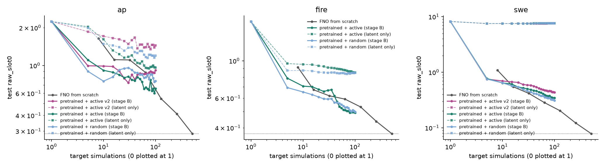

# Results: evaluation (phase 3) and few-shot active learning (phase 4)

Final model: A ∪ B pretraining, `pretrain_AB` step 200000 (4840 training equations, 280 rehearsal). Reference: the
A-only model, `pretrain_A` step 146955. Everything here is reproducible from `model/results/`
(`<run>_s<step>/results.json`, `active/<target>_<method>/history.jsonl`, `deck_*.json`; scratch curves in
`results/scratch/`, made by `baselines.py`).

**Metric** (`eval.summarize`): relL2 of frames 1–14 predicted from the IC at frame 0, on fixed 100-IC test sets.
`raw` = physical units per (trajectory, frame), mean over frames and ICs (= baselines.py `raw_*`, the headline).
`rel` = the training loss's relL2 in the per-trajectory normalized space (= `rel_*`). `slot0` = primary field (SWE
eta, AP u). On AP, `raw` is noisy: frames where u ≈ 0 inflate it, so `rel` is shown too. On data sets (val-IC,
rehearsal) only `rel` is meaningful, because some trajectories have near-zero truth.

## Headline: pretrained vs scratch data-efficiency (A ∪ B finals, stage B, 20 rounds × 5 sims)

The table gives the simulations each method needs to reach scratch's error at N scratch simulations (log-linear
interpolation between rounds); "×" = N / sims. The best acquisition is shown: random on both targets.

| target, metric | scratch N | scratch error | pretrained sims | × fewer |
|---|---:|---:|---:|---:|
| AP, raw | 16 | 1.11 | 5 (0.90 at 5) | ≥ 3.2 |
| AP, raw | **64** | **0.88** | **5.4** | **≈ 12×** |
| AP, raw | 128 | 0.54 | not reached in 100 (0.76) | < 1.3 |
| AP, rel | 32 | 0.56 | 8.3 | 3.9× |
| AP, rel | 64 | 0.45 | 52 | 1.2× |
| SWE, raw | 8 | 1.09 | 5 (0.75 at 5) | ≥ 1.6 |
| SWE, raw | 16 | 0.55 | 18.6 | 0.86× |
| SWE, raw | 32 | 0.42 | 39.8 | 0.80× |
| fire, raw | 16 | 0.67 | 7.1 | 2.3× |
| fire, raw | 64 | 0.59 | 29.8 | 2.1× |
| fire, raw | 128 | 0.53 | 63.5 (active: 51) | 2.0× (2.5×) |

So on AP, pretraining saves about 12× at the accuracy scratch reaches with 64 sims (raw 0.88), and about 4× at
scratch's N=32 level in the smoother training metric. The gain shrinks and disappears by about 100–128 sims. On fire,
pretraining needs about 2× fewer sims at every accuracy level that scratch reaches with 16 to 128 sims. On
SWE, pretraining only helps at the coarsest level (≤ 8 sims); beyond about 15 sims, scratch is as good or better
(SWE in mixed units is far from every pretraining equation). A-model reference: AP with active acquisition and
adapter stage B reaches raw 0.84 with 5 sims, against scratch's 0.88 at N=64 (12.8×).

Curves, raw_slot0, stage B, at sims 0 / 5 / 10 / 25 / 50 / 100:

| | random | active | active v2 | scratch (N = 8 / 16 / 32 / 64 / 128 / 512) |
|---|---|---|---|---|
| SWE | 8.18 / 0.75 / 0.64 / 0.49 / 0.39 / **0.31** | 8.18 / 0.77 / 0.64 / 0.52 / 0.44 / 0.34 | 8.18 / 0.75 / 0.70 / 0.60 / 0.51 / 0.44 | 1.09 / 0.55 / 0.42 / 0.28 / 0.20 / 0.08 |
| AP | 2.24 / **0.90** / 0.75 / 0.95 / 0.85 / 0.76 | 2.24 / 1.11 / 0.92 / 0.80 / 0.78 / 0.65 | 2.24 / 1.00 / 0.99 / 0.79 / 0.86 / 0.92 | 1.64 / 1.11 / 1.11 / 0.88 / 0.54 / 0.29 |
| fire | 1.71 / **0.69** / 0.65 / 0.59 / 0.56 / 0.50 | 1.71 / 0.79 / 0.71 / 0.66 / 0.54 / **0.49** | – | 0.91 / 0.67 / 0.62 / 0.59 / 0.53 / 0.37 |
| AP (rel) | 0.98 / 0.62 / 0.54 / 0.48 / 0.45 / **0.40** | 0.98 / 0.64 / 0.58 / 0.52 / 0.48 / 0.43 | 0.98 / 0.62 / 0.59 / 0.51 / 0.51 / 0.48 | 0.76 / 0.63 / 0.56 / 0.45 / 0.36 / 0.22 |

The latent-only curves (dashed in the plot) barely move on SWE and AP. On these unseen PDEs, adapting z alone does
not fit, and the fine-tuning branch (stage B) does the work.

## Secondary: acquisition

Once the backbone is fine-tuned, acquisition matters little and **random is a strong baseline**. In the finals,
random beats active on SWE (0.31 vs 0.34 at 100 sims) and in AP's training metric (0.40 vs 0.43); on AP raw they
trade places; on fire random leads up to 25 sims and active ends marginally ahead (0.49 vs 0.50). Active v2 (EPIG-style, `active_v2.py`) is the weakest on both (SWE 0.44, AP rel 0.48). On the A
model the picture is the same (A runs, adapter stage B):

| A model, raw at 5 / 25 / 50 / 100 | active | random | generic prior |
|---|---|---|---|
| AP | 0.84 / 0.68 / 0.61 / 0.74 | 0.87 / 0.71 / 0.71 / 0.71 | 0.93 / 0.64 / 0.59 / 0.59 |
| SWE | 0.95 / 0.79 / 0.77 / 0.75 | 0.89 / 0.76 / 0.70 / 0.69 | 0.88 / 0.74 / 0.72 / 0.72 |

## Phase 3 (A ∪ B; final A in brackets), rel_slot0 unless noted

| | latent table | swapped z | graph μ | graph, 32 samples | generic μ | generic, 32 samples | persistence |
|---|---|---|---|---|---|---|---|
| val-IC (held-out ICs) | 0.35 [0.39] | 1.97 [1.37] | 0.55 [0.53] | | 0.77 [0.77] | | 1.90 [1.37] |
| rehearsal (held-out structures) | | | 0.57 [0.62] | 0.57 [0.62] | 0.73 [0.70] | 0.89 [0.71] | 1.57 [1.10] |
| SWE, raw | | | 2.24 [2.23] | 2.24 [2.23] | 2.21 [2.25] | 2.17 [2.22] | 2.35 |
| AP, raw | | | 2.81 [1.35] | 2.75 [1.26] | 1.19 [1.68] | 1.58 [1.86] | 1.78 |

- **Latent collapse test:** swapping z between equations raises the val-IC error 5.5× in rel_all (0.35 → 1.90)
  [A: 4.3×; training log ~2.2 in the capped metric]. The backbone uses z.
- **Zero-shot:** on held-out structures the graph prior gives 0.57, against 0.73 generic and 1.57 persistence. On
  the targets, zero-shot fails: SWE ≈ persistence (all-zeros scores 1.0), and AP graph is 2.75 on A ∪ B (1.26 on
  A).
- **Graph vs generic prior:** the graph prior wins zero-shot on data equations (val-IC 0.55 vs 0.77, rehearsal
  0.57 vs 0.73) and on AP with the A model. It loses on AP with A ∪ B. In latent-only few-shot the generic prior wins
  on both targets (A model: SWE 1.07 vs 2.13, AP 0.95 vs 1.05 at 100 sims), because the graph prior is too narrow
  (next item).
- **Calibration:** on 60 A ∪ B rehearsal equations, z* fitted to all of an equation's windows falls inside 1σ / 2σ
  of p_phi 17.8% / 35.2% of the time (expected 68% / 95%). One temperature τ = 4.26 restores 69% / 95% [A: τ =
  4.64]. The A ∪ B finals used the tempered graph prior (σ → 4.26σ). Caveats:
  - Adam lets z* drift along weakly identified directions, which inflates τ.
  - The prior-predictive mean over tempered samples is poor (SWE 8.18, rehearsal 15.5), because isotropic draws at
    4σ leave the region the backbone was trained on.
  - Stage B was unaffected: a replay with z = μ (τ = 1) on the AP random sims gave the same errors.

## Update rule (stage B vs C), decided on the A model's acquired sims (`replay_*.jsonl`)

| raw at 5 / 50 / 100 | adapter B (A runs) | full B (finals) | stage C | stage C, cosine, patience 10 |
|---|---|---|---|---|
| SWE | 0.95 / 0.77 / 0.75 | 0.91 / 0.54 / **0.48** | 0.97 / 0.60 / 0.49 | – / 0.59 / 0.54 at 75 |
| AP | 0.84 / 0.61 / 0.74 | 0.94 / 0.65 / **0.57** | 1.10 / 0.66 / 0.57 | |

- **Full B** (`--stage b --ft_full --ft_lr 5e-4 --ft_pull 1e-4 --ft_steps 300`): all weights, 300 Adam steps per
  round warm-started, a weak pull toward the pretrained weights, z of each pair = a random particle.
- **Stage C** (`make_stage_c`): all weights + z, pull decaying as 5/N, early stopping on held-out acquired sims.
  It was never better than full B.
- The adapter (spectral banks frozen) underfits its own training sims on SWE.

## Setup notes

- SWE runs in mixed units (x in km, t in ks, eta in m; `targets.SWE_MIX`; README) so that log L and log T sit
  inside pretraining's range and the IC normalization floors are not hit.
- No pretraining equation has a second static, so for SWE static slot 1 (the sponge) gets slot 0's lift weights
  (`eval.adapt_statics`).
- Particles: K = 32, randomized MAP (each particle anchored to its own prior draw; anchoring all of them at μ
  collapsed the ensemble). Scoring: particle variance on a fresh 2000-candidate pool (`targets.sample`); 8 particles
  at 3 frame times; k-means into 5 clusters on knob features, top score per cluster.
- Every finals run stores its acquired sims (`state.npz`) and final weights (`ft.eqx`) under
  `pdebox3:/workspace/results/pretrain_AB_s200000/active/`.

Fire (`targets.py` "fire", added by the fire agent; the target after its 09:15 UTC revision) ran with the same
settings: active and random only, graph prior tempered by τ.
